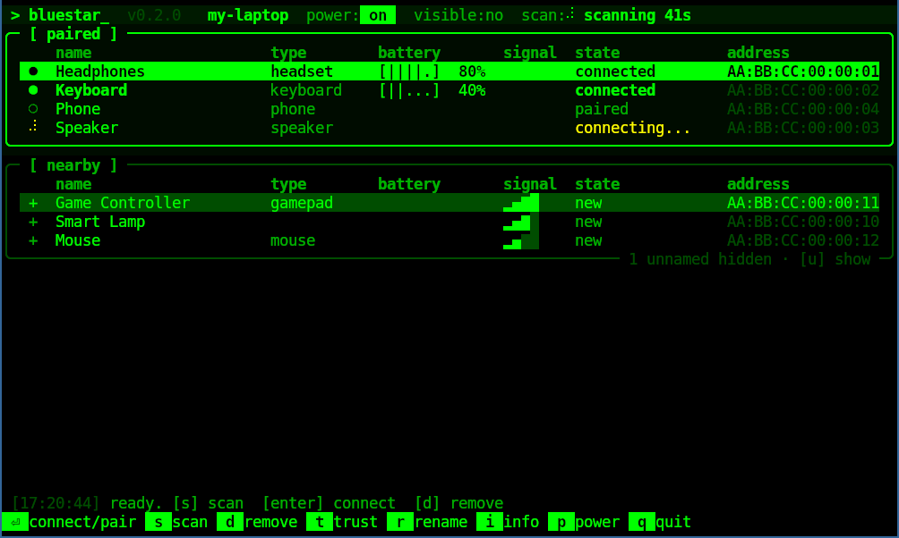

# bluestar

A Bluetooth manager for the terminal, and an alternative to blueman.
It's a [Textual](https://textual.textualize.io/) TUI on top of BlueZ's D-Bus API, with a green-on-black look, plus a
small tray daemon for your bar.



## Features

- **Scan** for nearby devices (auto-stops after 60 s). Devices that only report an address are hidden unless you ask for them.
- **Pair + connect** in one keystroke, with PIN, passkey and confirmation prompts handled by a built-in pairing agent.
- **Connect / disconnect** paired devices, with battery level and signal strength shown.
- **Remove**, trust, block and rename devices, plus an info view with supported profiles.
- **Adapter**: power on/off (unblocks rfkill if needed) and visibility.
- **Tray daemon** (`--tray`): a StatusNotifierItem icon that works with waybar, KDE and others, with no GTK or appindicator.
  - Left-click opens or closes the TUI in a floating terminal.
  - The right-click menu toggles power and connects or disconnects paired devices.
  - It notifies you when devices connect or disconnect.
  - It answers pairing requests while the TUI is closed, using notification buttons.

## Keys

| key | action |
| --- | --- |
| `s` | start / stop scan |
| `enter` | connect / disconnect, or pair + connect a new device |
| `x` | disconnect |
| `d` | remove (forget) device |
| `t` / `b` | toggle trusted / blocked |
| `r` | rename |
| `i` | device info |
| `p` | power adapter on / off |
| `v` | toggle visibility to other devices |
| `u` | show / hide unnamed nearby devices |
| `q` / `esc` | quit |

The mouse works too. `↑`/`↓` move between the paired and nearby lists.

## Requirements

- BlueZ 5 (`bluetoothd` running)
- Python 3 with Textual and dbus-fast

On Debian/Ubuntu:

```sh
sudo apt install python3-textual python3-dbus-fast bluez
```

## Usage

```sh
git clone https://github.com/dellambrogio/bluestar.git
cd bluestar
./bin/bluestar            # run the TUI in the current terminal
./bin/bluestar --toggle   # open the TUI in a new terminal window, or close it
./bin/bluestar --tray     # background daemon: tray icon, notifications, pairing agent
./bin/bluestar --daemon   # same, without a tray icon (e.g. if your bar has its own bluetooth module)
```

Link it into your `PATH` if you like: `ln -s "$PWD/bin/bluestar" ~/.local/bin/bluestar`.

`--toggle` and the tray icon start the TUI in kitty, foot, alacritty, wezterm or ghostty (whichever is found first), with
the window class / app_id `bluestar`. To use something else, set `"terminal"` in `~/.config/bluestar/settings.json`,
e.g. `["foot", "--app-id", "bluestar"]`.

Under sway, the TUI moves its own floating window into the bottom-right corner of the workspace, above the bar.
sway ignores `move` commands in a `for_window` rule while the terminal is still sizing its window, which is why the
TUI does it itself. Set `"position"` in the settings file to `bottom-left`, `top-right`, `top-left` or `null`.

### sway / waybar

```
# ~/.config/sway/config
exec sleep 2 && ~/.local/bin/bluestar --daemon     # or --tray for an icon with a quick-connect menu
for_window [app_id="bluestar"] floating enable, resize set 1000 600
```

```jsonc
// ~/.config/waybar/config.jsonc
"bluetooth": {
    "on-click": "~/.local/bin/bluestar --toggle"
}
```

If you were using blueman, stop `blueman-applet` so the two pairing agents don't compete.

## Layout

| File | Purpose |
| --- | --- |
| `bluestar/bluez.py` | asyncio mirror of `org.bluez` (adapters, devices, battery) on dbus-fast |
| `bluestar/tui.py` | the Textual app, dialogs and theme |
| `bluestar/agent.py` | `org.bluez.Agent1` pairing agent with pluggable prompts |
| `bluestar/daemon.py` | `--tray` / `--daemon`: tray icon, notifications, background pairing agent |
| `bluestar/tray.py` | StatusNotifierItem + dbusmenu |
| `bluestar/notify.py` | desktop notifications with action buttons |
| `bluestar/util.py` | labels, settings, terminal launching |

Settings live in `~/.config/bluestar/settings.json`.

## License

GPL-3.0-or-later
